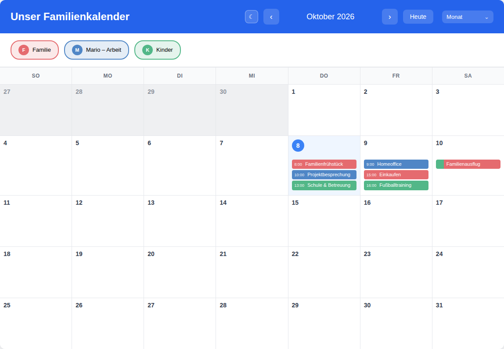
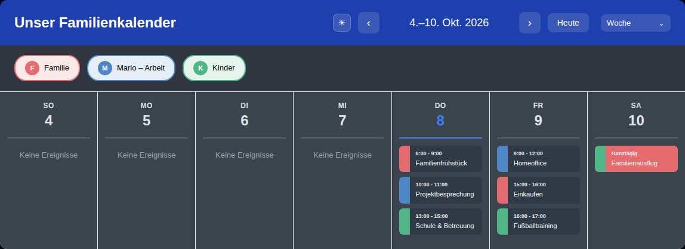
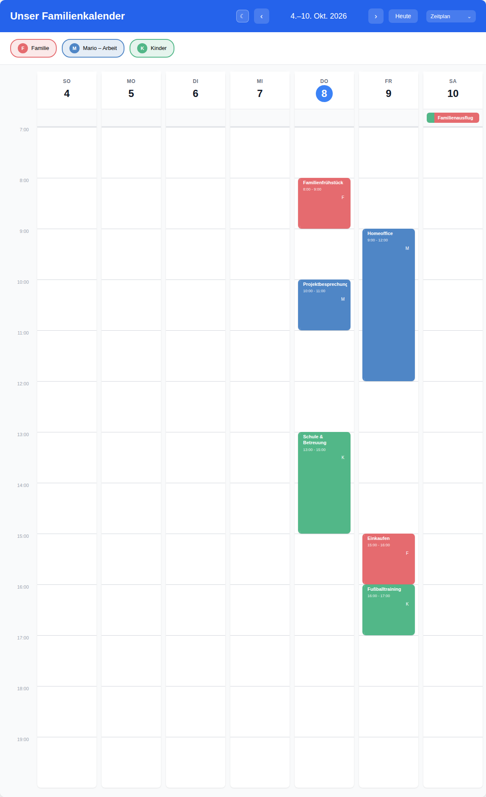
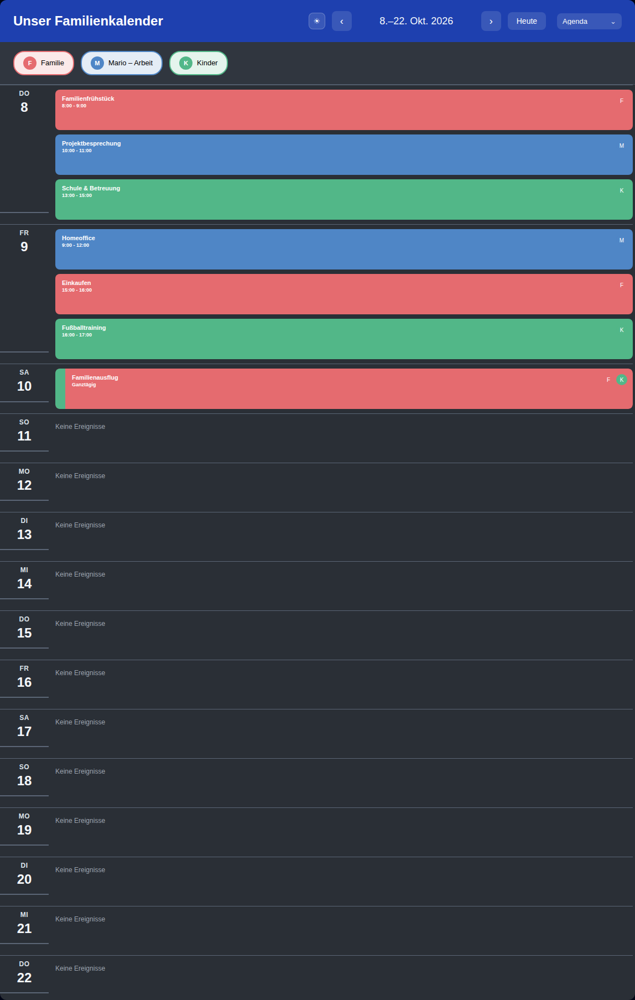
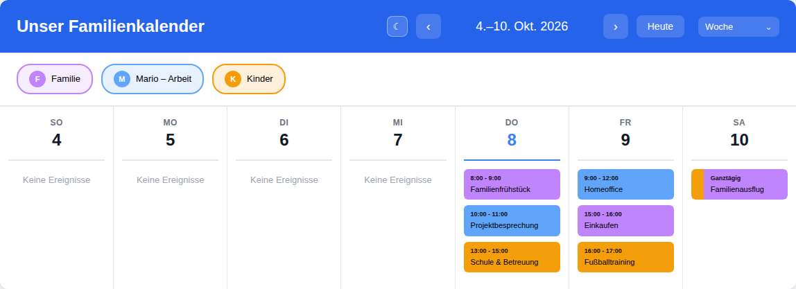
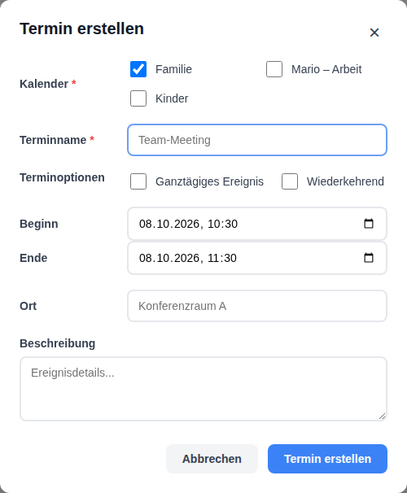
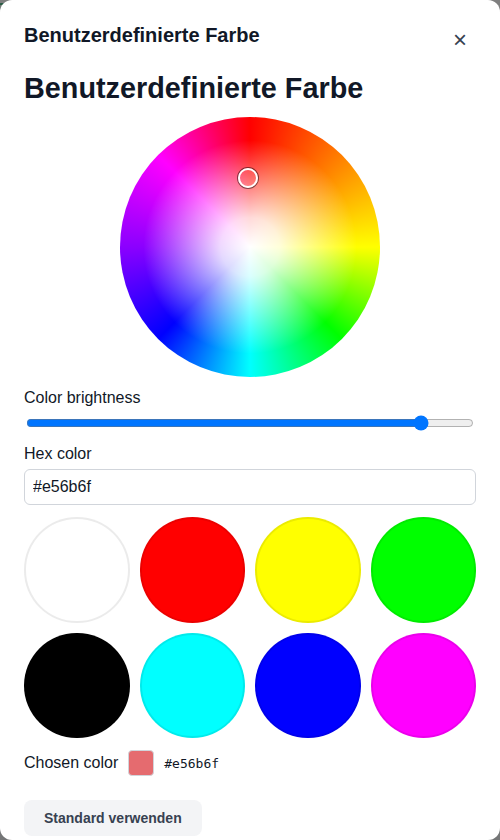
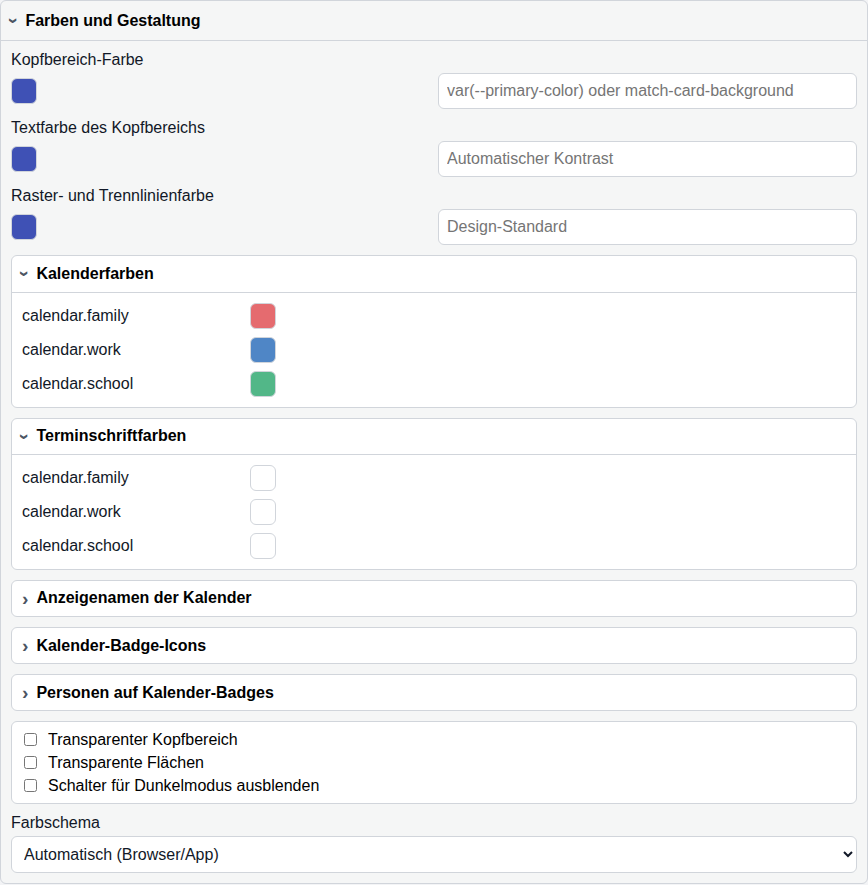
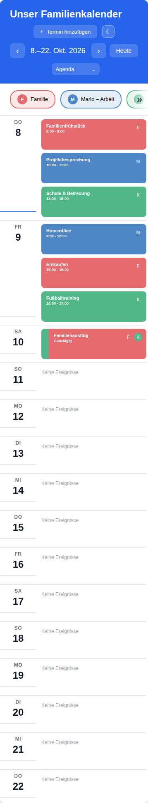

# Family Calendar Card for Home Assistant

[](https://github.com/hacs/integration)
[](https://github.com/Baeka89)
[](https://paypal.me/misomazo)
[](LICENSE)

[Deutsch](#deutsch) | [English](#english) · [Changelog](CHANGELOG.md)

<a id="deutsch"></a>

## Deutsch 🇩🇪

### 1. Projekt und Kurzbeschreibung

Family Calendar Card ist eine Dashboard-Karte für Home Assistant. Sie stellt mehrere Kalender gemeinsam dar und wird von Baeka89 gepflegt.

### 2. Projektzweck und Funktionsumfang

Vier Ansichten: Monat, Woche, Schedule und Agenda. Kalenderfarben, Familienmitglieder, Wetter, virtuelle Kalender, Tages-Badges, individuelle Terminstile und zusätzliche Header-Schaltflächen lassen sich konfigurieren. Termine können abhängig von den Fähigkeiten und Schreibrechten der Kalenderintegration erstellt, bearbeitet, weitergeleitet und gelöscht werden. Beschreibungen unterstützen Markdown und eine eingeschränkte Auswahl von HTML-Tags.

### 3. Systeme und Voraussetzungen

Home Assistant mit mindestens einer `calendar`-Entität und einem Browser mit Unterstützung für benutzerdefinierte Web-Komponenten. Optional: `weather`- und `person`-Entitäten. Terminänderungen erfordern eine schreibfähige Kalenderintegration. Eine verbindliche Home-Assistant-Mindestversion ist in den Projektmetadaten bisher nicht angegeben; eine pauschale Kompatibilitätszusage für alle Versionen wird nicht gemacht.

Karte, Editor und Begleitintegration unterstützen Deutsch, Englisch, Französisch, Niederländisch, Spanisch, Estnisch, Katalanisch, Dänisch und Schwedisch. Nicht unterstützte Sprachen verwenden Englisch.

### 4. Installation

1. In HACS nach **Family Calendar Card** suchen. Falls die Karte noch nicht im Standardkatalog erscheint, `https://github.com/Baeka89/family-calendar-card` als benutzerdefiniertes Repository vom Typ **Dashboard** hinzufügen.
2. Karte herunterladen. HACS verwaltet die Frontend-Datei; die Begleitintegration wird dabei nicht installiert.
3. Dashboard neu laden und die von HACS angelegte JavaScript-Modulressource prüfen.
4. Eine manuelle Karte mit `type: custom:family-calendar-card` hinzufügen.

Manuell: `family-calendar-card.js` aus dem gewünschten Release nach `/config/www/family-calendar-card.js` kopieren. Unter Dashboard-Ressourcen `/local/family-calendar-card.js` als **JavaScript-Modul** eintragen und das Dashboard neu laden. Die Kompatibilitätsbezeichnung `custom:family-calendar-card-legacy` bleibt unterstützt.

### 5. Einrichtung und Authentifizierung

Die Karte nutzt die vorhandene Home-Assistant-Anmeldung; separate Zugangsdaten sind nicht erforderlich. Kalender im visuellen Editor oder unter `entities` auswählen.

**Optionale Begleitintegration:** [Family Calendar Card Companion](https://github.com/Baeka89/family-calendar-card-companion) separat über HACS installieren, Home Assistant neu starten und unter **Einstellungen → Geräte & Dienste → Integration hinzufügen** einrichten. Nur die gemeinsame zusätzliche Anzeigezuordnung benötigt sie. Die Karte bleibt ohne Integration nutzbar.

### 6. Konfiguration und Optionen

Einfacher Einstieg:

```yaml
type: custom:family-calendar-card
title: Familienkalender
entities:
  - calendar.family
  - calendar.work
  - calendar.birthdays
default_view: agenda
compact_height: false
rolling_days_agenda: 2
hide_empty_days: true
agenda_text_alignment: left
hide_badge_calendars:
  - calendar.birthdays
```

Die Entitäts-IDs sind Beispiele und durch eigene vorhandene Kalender zu ersetzen. `rolling_days_agenda: 2` zeigt heute plus zwei weitere Tage. `compact_height: false` richtet die Höhe nach dem Inhalt; `hide_empty_days: true` entfernt leere Tage. `agenda_text_alignment: left` richtet den Agenda-Text links aus. `hide_badge_calendars` blendet Kalender-Badges in allen Ansichten und Termindetails aus, ohne die Termine zu entfernen. Ein Eintrag wirkt nur für den entsprechenden tatsächlich verwendeten Kalender. Weitere Optionen: [Konfigurationsdokumentation](docs/configuration).

### 7. Verwendung

Termin anklicken, um Details und verfügbare Aktionen zu öffnen. Bei installierter und verbundener Begleitintegration unter **Betrifft auch diese Kalender** zusätzliche in der Karte konfigurierte Kalender auswählen und speichern. Das verändert den Originaltermin nicht und funktioniert auch für schreibgeschützte Einladungen. Bei Serien gilt die Zuordnung für das ausgewählte Vorkommen.

Die Zuordnungen liegen zentral in Home Assistant und gelten für alle Geräte und Benutzer derselben Instanz. Individuelle Terminfarben und Sichtbarkeitspräferenzen bleiben lokale Kartenfunktionen. Das Schließen eines Popups oder ein Klick auf dessen Hintergrund verwirft ungespeicherte Eingaben.

[Alle 48 Beispielbilder und Konfigurationen](docs/images/gallery/README.md). Die Bilder stammen aus einem früheren Projektstand; einzelne Beschriftungen und Details können abweichen. Überholte Bilder zur früheren Browser-Zuordnung sind in der Galerie als historisch gekennzeichnet.



Monatsübersicht: Kalender gemeinsam mit ihren Farben anzeigen.



Dunkle Wochenansicht: Tagesspalten und Termine.



Schedule: Termine im Stundenraster.



Dunkle Agenda: Termine als Liste.



Kalenderfarben: unterschiedliche Farbpaletten verwenden.



Termin erstellen: Kalender, Zeiten und Wiederholung auswählen.



Terminfarbe: eine individuelle Farbe auswählen.



Visueller Editor: Farboptionen konfigurieren.



Mobile Agenda: Darstellung auf schmalen Bildschirmen.

### 8. Aktualisierung und Migration

Karte und Begleitintegration separat über HACS aktualisieren. Nach einem Kartenupdate das Dashboard neu laden; bei veralteter Anzeige den Browsercache prüfen. Bei manueller Installation die Moduldatei ersetzen. Nach einem Update der Begleitintegration Home Assistant neu starten.

Bestehende Browser-Zuordnungen werden nicht automatisch in die Integration übertragen: gewünschte Kalender erneut auswählen und speichern. Die Begleitintegration übernimmt bestehendes `family_calendar_card:`-YAML in einen UI-Eintrag; den YAML-Eintrag nach erfolgreicher Übernahme entfernen. Die bisherigen Elementnamen und Speicherschlüssel bleiben erhalten.

### 9. Einschränkungen und Fehlerbehebung

Ohne verbundene Begleitintegration zeigt die zusätzliche Zuordnung einen Einrichtungshinweis und bietet keine lokale Ersatzspeicherung an. Alle authentifizierten Home-Assistant-Benutzer dürfen gemeinsame Zuordnungen bearbeiten. Schreibrechte, stabile Ereigniskennungen und Serienbearbeitung hängen von der Kalenderintegration ab; nach einer Änderung von Titel oder Datum kann ohne stabile Kennung eine erneute Zuordnung nötig sein.

Reserviert das Dashboard trotz Inhaltshöhe Leerraum, feste Höhenvorgaben des umgebenden Layouts prüfen. Bei fehlenden Aktionen Kalenderrechte prüfen; bei fehlender Zuordnung die Begleitintegration und deren Verbindung prüfen. HTML-Beschreibungen werden mit einem HTML-Parser auf erlaubte Formatierungselemente reduziert. Skripte, fremde HTML-Attribute und aktive eingebettete Inhalte werden entfernt. Links mit Leerzeichen, Steuerzeichen, Anführungszeichen, spitzen Klammern oder Rückwärtsschrägstrichen werden ohne anklickbares Linkziel angezeigt; normale Web-, E-Mail-, Telefon-, lokale und Ankerlinks bleiben verfügbar.

### 10. Entwicklung und Tests

Quellcode unter `src/` bearbeiten und das ausgelieferte Bundle mit `npm run build` erzeugen. Node-Tests: `npm test`; Syntaxprüfung: `node test/check-sources.cjs`; Browser- und Bildvergleichstests: `npm run test:visual`. Die Sicherheitsregressionen liegen in `playwright/security.spec.js`. Voraussetzungen und vollständiger Ablauf: [DEVELOPMENT.md](DEVELOPMENT.md).

Ein lokaler Test ersetzt keine Prüfung in einer echten Home-Assistant-Installation. Den tatsächlich ausgeführten Prüfungsumfang zum jeweiligen Änderungsstand dokumentieren.

### 11. Versionshistorie

[CHANGELOG.md](CHANGELOG.md) und [GitHub-Releases](https://github.com/Baeka89/family-calendar-card/releases). Ein Push allein erzeugt keine neue Version. Diese Version enthält die Korrekturen der HTML-Ausgabe.

### 12. Unterstützung, Mitwirkung und Lizenz

Fehler und Vorschläge: [GitHub Issues](https://github.com/Baeka89/family-calendar-card/issues). Kartenversion, Home-Assistant-Version, Kalenderintegration und Schritte zum Nachstellen nennen; persönliche Termindaten entfernen. Beiträge sind über Pull Requests möglich. Danke an die Home-Assistant- und HACS-Community sowie an die Beitragenden und Prüfenden.

Maintainer: [Baeka89](https://github.com/Baeka89). Unterstützung: [PayPal](https://paypal.me/misomazo). Lizenz: [MIT](LICENSE).

<a id="english"></a>

## English 🇺🇸

### 1. Project and summary

Family Calendar Card is a Home Assistant dashboard card. It displays multiple calendars together and is maintained by Baeka89.

### 2. Purpose and features

Four views: Month, Week, Schedule and Agenda. Configure calendar colors, family members, weather, virtual calendars, day badges, event styles and additional header buttons. Events can be created, edited, forwarded and deleted depending on the capabilities and write permissions of the calendar integration. Descriptions support Markdown and a restricted selection of HTML tags.

### 3. Systems and requirements

Home Assistant with at least one `calendar` entity and a browser supporting custom web components. Optional: `weather` and `person` entities. Editing events requires a writable calendar integration. Project metadata does not currently declare a binding minimum Home Assistant version; compatibility with every version is not claimed.

The card, editor and companion support German, English, French, Dutch, Spanish, Estonian, Catalan, Danish and Swedish. Unsupported languages fall back to English.

### 4. Installation

1. Search HACS for **Family Calendar Card**. If it is not listed in the default catalog yet, add `https://github.com/Baeka89/family-calendar-card` as a custom repository of type **Dashboard**.
2. Download the card. HACS manages the frontend file; this does not install the companion.
3. Reload the dashboard and check the JavaScript module resource created by HACS.
4. Add a manual card with `type: custom:family-calendar-card`.

Manual installation: copy `family-calendar-card.js` from the desired release to `/config/www/family-calendar-card.js`. Add `/local/family-calendar-card.js` as a **JavaScript module** under dashboard resources and reload the dashboard. The compatibility name `custom:family-calendar-card-legacy` remains supported.

### 5. Setup and authentication

The card uses your existing Home Assistant login; no separate credentials are required. Select calendars in the visual editor or under `entities`.

**Optional companion:** install [Family Calendar Card Companion](https://github.com/Baeka89/family-calendar-card-companion) separately through HACS, restart Home Assistant and set it up under **Settings → Devices & services → Add integration**. Only shared additional display assignments require it. The card remains usable without the integration.

### 6. Configuration and options

Getting started:

```yaml
type: custom:family-calendar-card
title: Family calendar
entities:
  - calendar.family
  - calendar.work
  - calendar.birthdays
default_view: agenda
compact_height: false
rolling_days_agenda: 2
hide_empty_days: true
agenda_text_alignment: left
hide_badge_calendars:
  - calendar.birthdays
```

Entity IDs are examples; replace them with your existing calendars. `rolling_days_agenda: 2` shows today plus two more days. `compact_height: false` sizes the card to its content; `hide_empty_days: true` omits empty days. `agenda_text_alignment: left` aligns Agenda text to the left. `hide_badge_calendars` hides calendar badges in every view and event details without removing events. An entry only affects the corresponding calendar actually in use. More options: [configuration documentation](docs/configuration).

### 7. Usage

Click an event to open its details and available actions. With an installed and connected companion, select additional calendars configured in the card under **Also concerns these calendars** and save. This leaves the source event unchanged and also works for read-only invitations. Recurring assignments apply to the selected occurrence.

Assignments are stored centrally in Home Assistant and apply across devices and users of the same instance. Custom event colors and visibility preferences remain local card features. Closing a popup or clicking its backdrop discards unsaved input.

[All 48 example screenshots and configurations](docs/images/gallery/README.md). Images were captured from an earlier project version; individual labels and details may differ. Obsolete browser-assignment examples are marked as historical in the gallery.


Month overview: display calendars together using their colors.


Dark week view: day columns and events.


Schedule: events in an hourly grid.


Dark Agenda: events in a list.


Calendar colors: use different palettes.


Create an event: select calendars, times and recurrence.


Event color: select a custom color.


Visual editor: configure color options.


Mobile Agenda: layout on narrow screens.

### 8. Updates and migration

Update the card and companion separately through HACS. Reload the dashboard after a card update; check the browser cache if the old display remains. For manual installations, replace the module file. Restart Home Assistant after a companion update.

Existing browser-only assignments are not automatically transferred to the integration: select the desired calendars again and save. The companion imports existing `family_calendar_card:` YAML into a UI entry; remove the YAML entry after successful import. Existing element names and storage keys are preserved.

### 9. Limitations and troubleshooting

Without a connected companion, the additional-assignment section displays setup information and provides no browser-only fallback. All authenticated Home Assistant users can edit shared assignments. Write access, stable event identifiers and recurrence editing depend on the calendar integration; without a stable identifier, changing a title or date may require assigning the event again.

If the dashboard reserves empty space despite content height, check fixed height settings in its surrounding layout. For missing actions, check calendar permissions; for unavailable assignments, check the companion and its connection. HTML descriptions are reduced to allowed formatting elements using an HTML parser. Scripts, unapproved HTML attributes and active embedded content are removed. Links containing whitespace, control characters, quotes, angle brackets or backslashes are displayed without a clickable target; normal web, email, telephone, local and anchor links remain available.

### 10. Development and tests

Edit source files under `src/` and generate the shipped bundle with `npm run build`. Node tests: `npm test`; syntax checks: `node test/check-sources.cjs`; browser and screenshot tests: `npm run test:visual`. Security regressions are in `playwright/security.spec.js`. Requirements and full instructions: [DEVELOPMENT.md](DEVELOPMENT.md).

Local tests do not replace testing in a real Home Assistant installation. Document the checks actually performed for each change.

### 11. Version history

[CHANGELOG.md](CHANGELOG.md) and [GitHub releases](https://github.com/Baeka89/family-calendar-card/releases). A push alone does not create a new version. This version includes the HTML output corrections.

### 12. Support, contributing and license

Bugs and suggestions: [GitHub Issues](https://github.com/Baeka89/family-calendar-card/issues). Include the card version, Home Assistant version, calendar integration and reproduction steps; remove personal event data. Contributions through pull requests are welcome. Thanks to the Home Assistant and HACS communities, contributors and reviewers.

Maintainer: [Baeka89](https://github.com/Baeka89). Support: [PayPal](https://paypal.me/misomazo). License: [MIT](LICENSE).
